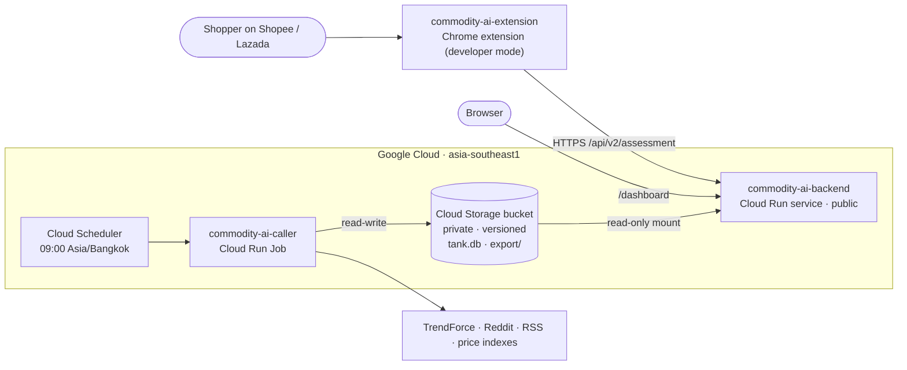

# Commodity AI — backend (API + price receipt)

Commodity AI tells a shopper whether a RAM, SSD or GPU listing on Shopee or Lazada is priced below, within or above
a reference range, and whether now looks like a reasonable time to buy. This repo is the public API and the
"price receipt" dashboard. It is stateless: it only reads the export that
[commodity-ai-caller](https://github.com/MobyDIGG-commidtyAI/commodity-ai-caller) refreshes every day.

The browser extension that calls it is
[commodity-ai-extension](https://github.com/MobyDIGG-commidtyAI/commodity-ai-extension).

## Architecture



## API

| Endpoint | What it returns |
|---|---|
| `GET /api/v2/assessment?title=...&price=...` | Product match, price verdict against the reference band, seasonal context, 90-day outlook, history, evidence (used by the extension) |
| `GET /dashboard?title=...&price=...` | The price receipt page for one listing |
| `GET /api/health` | Status, dataset version and as-of date (uptime check) |
| `GET /api/verdict`, `GET /api/series` | Legacy baseline endpoints (fair value from lagged chip prices) |
| `GET /api/docs` | OpenAPI docs |

Method and limits of the assessment: [docs/assessment-v2.md](docs/assessment-v2.md).

## Run locally

```bash
python3.12 -m venv .venv && . .venv/bin/activate
pip install -r requirements.txt -r requirements-dev.txt
DATA_DIR=data/export PYTHONPATH=src uvicorn api.app:app --port 8000
open "http://localhost:8000/dashboard?title=Kingston%20FURY%20Beast%20DDR5%2032GB%20(2x16GB)&price=21900"
```

The repo ships **no data**. The API reads the export that commodity-ai-caller publishes to the bucket
(`price_daily.parquet` and `assessment_snapshot.json`). Locally, copy it and point `DATA_DIR` at it:

```bash
gcloud storage rsync gs://<PROJECT>-cai-tank/export data/export     # needs read access to the bucket
DATA_DIR=data/export PYTHONPATH=src uvicorn api.app:app --port 8000
```

Without data, `/api/health` and every data endpoint answer 503 with the path they looked at; nothing is guessed.
The API reloads the files when the refresh job replaces them.

## Test

```bash
python -m pytest -q
```

The Python/JS parser parity test runs when a checkout of commodity-ai-extension sits next to this repo
(or `EXTENSION_DIR` points at its `extension/` folder); otherwise it is skipped.

## Deploy (Google Cloud)

```bash
PROJECT=<gcp-project> deploy/gcp.sh all      # APIs, Artifact Registry, private bucket, service accounts, build, Cloud Run, uptime alert
PROJECT=<gcp-project> deploy/gcp.sh build deploy
```

The service runs as `cai-api` with read-only access to the bucket, mounted at `/mnt/tank` (`DATA_DIR=/mnt/tank/export`).
The bucket is private (public access prevention on); clients only reach data through this API.
Settings: `REGION`, `BUCKET`, `MIN_INSTANCES`, `TH_MARKUP`, `CORS_ORIGINS` (empty = no CORS headers; the extension and the
same-origin dashboard do not need them), `ALERT_EMAIL`.

## Limits

- Prices are US references (retail price index, deal posts, chip spot) converted to THB; the Thai-market markup is not calibrated.
- Category references for RAM/SSD do not control for speed, latency, brand or warranty.
- The 90-day outlook is labelled as an illustrative scenario unless it passes rolling validation.
- `src/cai/{assessment,product,deals}.py` are shared with commodity-ai-caller (the caller's copy is the source).

## License

MIT
